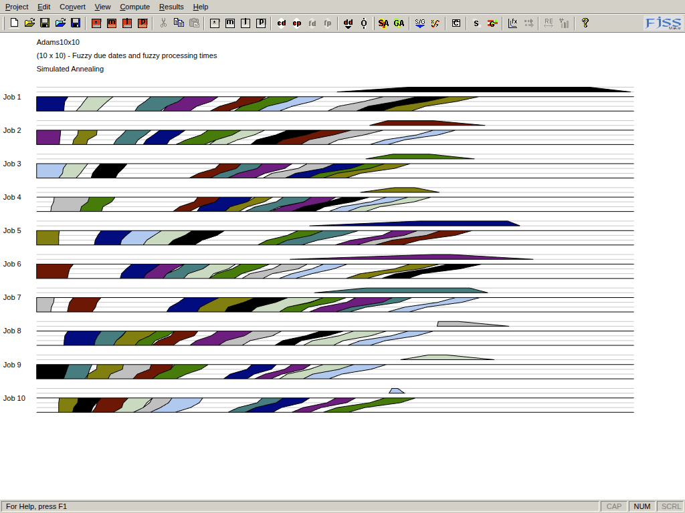

# FJSS Maker

Fuzzy Job Shop Scheduling: a 1:1 port of the 2002 C++/MFC desktop app **FJSSM**
to Deno + [aio](https://github.com/riagentic/aio). Same algorithms, same file
formats, same Win2000 look — in English (default) or the original Czech.



## Features

- Fuzzy (trapezoidal) and crisp processing times and due dates
- Giffler–Thompson, critical path, 10 objective criteria (MAX/SUM)
- Simulated annealing and genetic algorithm (MSX) solvers, live progress
- Convergence and criteria experiments (RE/ARE)
- Binary `.jss` files (byte-exact round-trip with the original), CSV
  import/export
- Grid, fuzzy Gantt chart, charts, reports, all 11 original dialogs, F1 help
- English / Czech UI and help: **Help → Language**, remembered per window

## Run

```sh
# one line: installs what is missing, builds, starts
curl -fsSL https://raw.githubusercontent.com/riagentic/aio/main/run.sh | sh -s riagentic/fjssm
```

From a clone (needs [`am`](https://github.com/riagentic/aio)):

```sh
am fix                     # link the aio version pinned in deno.json
deno task dev              # Electron desktop window
deno task dev:headless     # server only
deno task test             # unit + integration tests
deno task build            # browser + Electron (AppImage/.dmg/.exe) → dist/
```

Sample projects: `fjssm-original/Testing Examples/*.jss`.

## Layout

```
src/lib/        algorithms (fuzzy numbers, engine, criteria, SA/GA, I/O)
src/cell/       app state (one aio cell; solvers run server-side)
src/ui/         menus, toolbars, grid, Gantt, charts, dialogs
src/test/       tests
fjssm-original/ the 2002 C++ MFC sources the port follows
```

## Fidelity

Kept on purpose: original quirks (G&T conflict set tests fuzzy component 0 only,
criterion 8 beta penalty is 0, integer-division conversions, MSVC `rand()`).

Changed on purpose:

- Uninitialized / unreachable C++ paths return the intended value.
- SA/GA runs are paced to their time budget so progress is visible; the result
  is unchanged.
- Open/Save use browser pick/download; nothing persists between launches.
- MSChart plots are redrawn as SVG.

## License

[MIT](LICENSE). Third-party components under `fjssm-original/` (CGridCtrl,
BCMenu, CButtonST, …) keep their own licenses, stated in their headers.
